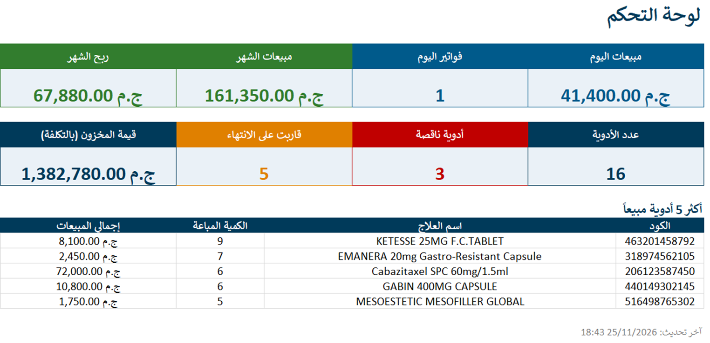
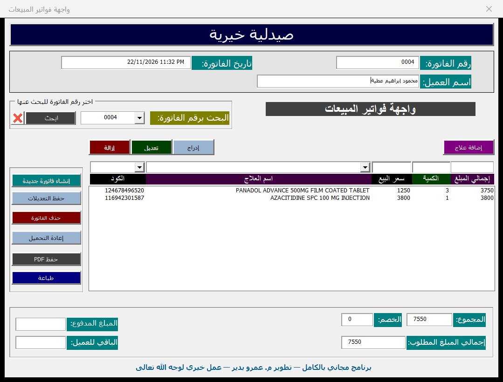
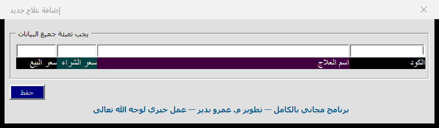
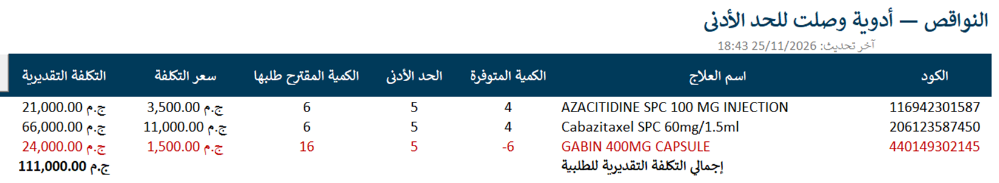
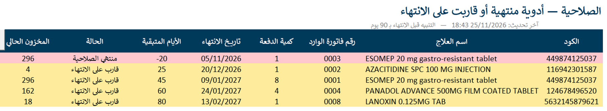
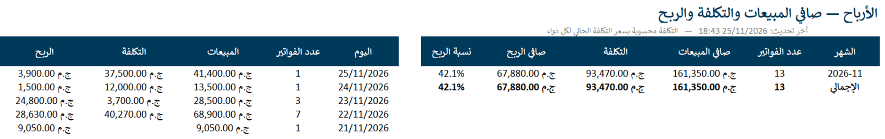
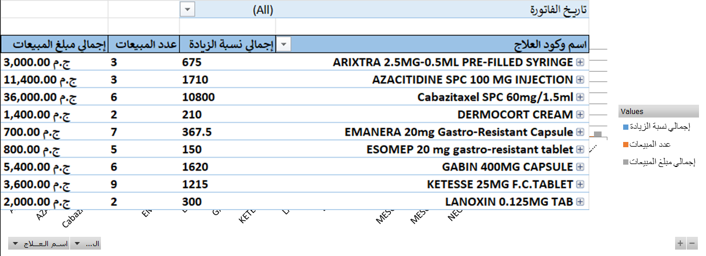
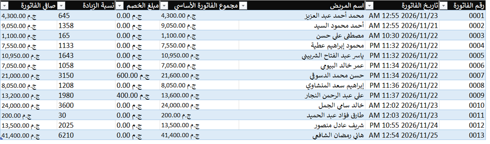
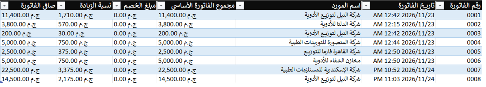

# 💊 نظام إدارة صيدلية — مجاني بالكامل (Excel)

نظام عربي متكامل لإدارة صيدلية صغيرة أو صيدلية خيرية، شغال جوه **Microsoft Excel** بالماكرو (VBA).
مش محتاج إنترنت ولا تسطيب برامج ولا قواعد بيانات. افتح الملف وابدأ شغل.

> **تطوير: م. عمرو بدير** 
> عمل خيري لوجه الله تعالى. البرنامج **مجاني بالكامل ولا يجوز بيعه**. لو استفدت منه، ادعُ لصاحبه ولوالديه بالخير. 🤍

  <a href="https://github.com/AmrBedir/Pharmacy-System-Excel/releases/latest"><b>⬇️ تحميل البرنامج (آخر إصدار)</b></a>
  &nbsp;•&nbsp;
  <a href="https://amrbedir.github.io/Pharmacy-System-Excel/"><b>🌐 صفحة البرنامج</b></a>
  &nbsp;•&nbsp;
  <a href="https://t.me/Stargito"><b>💬 تواصل على تليجرام</b></a>

  

---

## 📑 المحتويات

- [المميزات](#-المميزات)
- [التحميل: أنهي نسخة أنزّل؟](#️-التحميل-أنهي-نسخة-أنزل)
- [المتطلبات](#️-المتطلبات)
- [التشغيل خطوة بخطوة](#-التشغيل-خطوة-بخطوة)
- [شرح البرنامج بالصور](#-شرح-البرنامج-بالصور)
  - [1. شاشة البداية «عن البرنامج»](#1-شاشة-البداية-عن-البرنامج)
  - [2. لوحة التحكم](#2-لوحة-التحكم)
  - [3. الأدوية والمخزون والحد الأدنى](#3-الأدوية-والمخزون-والحد-الأدنى)
  - [4. فاتورة بيع جديدة](#4-عمل-فاتورة-بيع-جديدة)
  - [5. قارئ الباركود](#5-قارئ-الباركود)
  - [6. منع البيع بأكتر من المخزون](#6-منع-البيع-بأكتر-من-المخزون)
  - [7. البحث والتعديل والحذف](#7-البحث-عن-فاتورة-وتعديلها-أو-حذفها)
  - [8. الطباعة وحفظ PDF](#8-الطباعة-وحفظ-pdf)
  - [9. إضافة علاج جديد](#9-إضافة-علاج-جديد)
  - [10. فواتير الواردات وتاريخ الانتهاء](#10-فواتير-الواردات-وتاريخ-الانتهاء)
  - [11. النواقص](#11-النواقص)
  - [12. الصلاحية](#12-الصلاحية)
  - [13. الأرباح](#13-الأرباح)
  - [14. التقرير الإجمالي](#14-التقرير-الإجمالي)
  - [15. النسخة الاحتياطية](#15-النسخة-الاحتياطية)
  - [16. تنبيهات فتح البرنامج](#16-تنبيهات-فتح-البرنامج)
  - [17. سجلات الفواتير](#17-سجلات-الفواتير)
- [ابدأ ببيانات صيدليتك](#-ابدأ-ببيانات-صيدليتك)
- [مشاكل شائعة وحلولها](#️-مشاكل-شائعة-وحلولها)
- [أسئلة شائعة](#-أسئلة-شائعة)
- [ملاحظات تقنية](#-ملاحظات-تقنية-للمطورين)
- [سجل التحديثات](#-سجل-التحديثات)
- [تواصل معي](#-تواصل-معي)
- [ادعم المشروع](#-ادعم-المشروع)

---

## ✨ المميزات

| | الميزة | التفاصيل |
|---|---|---|
| 💊 | **إدارة الأدوية** | الكود، الاسم، سعر البيع، سعر التكلفة، الكمية المتوفرة، والحد الأدنى |
| 🧾 | **فواتير المبيعات** | إنشاء، بحث، تعديل، حذف. **المخزون بيتخصم تلقائي** |
| 📦 | **فواتير الواردات** | تسجيل المشتريات من الموردين **بتاريخ الانتهاء لكل صنف**. المخزون بيزيد تلقائي |
| 📷 | **قارئ الباركود** | امسح الكود ← الصنف يتضاف لوحده، وكل مسحة زيادة بتزود الكمية 1 |
| 🚫 | **منع البيع بالسالب** | البرنامج مش بيسمحلك تبيع أكتر من الكمية المتاحة |
| 📊 | **لوحة تحكم** | مبيعات اليوم والشهر، ربح الشهر، النواقص، الصلاحية، قيمة المخزون، وأكثر 5 أدوية مبيعاً |
| ⚠️ | **النواقص** | قائمة الأدوية اللي وصلت للحد الأدنى بالكمية المقترح طلبها والتكلفة، جاهزة للطباعة |
| ⏳ | **الصلاحية** | الأدوية المنتهية أو اللي هتنتهي خلال 90 يوم |
| 💰 | **الأرباح** | صافي المبيعات والتكلفة والربح لكل شهر ولكل يوم |
| 🔔 | **تنبيهات** | أول ما تفتح البرنامج بيقولك لو فيه نواقص أو أدوية قربت تنتهي |
| 💾 | **نسخة احتياطية** | زرار واحد يحفظ نسخة من الملف بالتاريخ والوقت |
| 🖨️ | **طباعة و PDF** | نموذج فاتورة جاهز للطباعة، وحفظ أي فاتورة PDF بضغطة |
| 🇪🇬 | **مصري** | كل المبالغ بالجنيه (ج.م)، وواجهة عربية بالكامل |
| 🆓 | **مجاني 100%** | مفتوح المصدر، استخدمه وانشره |

---

## ⬇️ التحميل: أنهي نسخة أنزّل؟

من صفحة **[آخر إصدار (Releases)](https://github.com/AmrBedir/Pharmacy-System-Excel/releases/latest)** هتلاقي ملفين:

| الملف | لمين؟ |
|---|---|
| [`Pharmacy-Empty.xlsm`](https://github.com/AmrBedir/Pharmacy-System-Excel/releases/latest/download/Pharmacy-Empty.xlsm) | ✅ **للاستخدام الفعلي**: نسخة فاضية، تبدأ فيها بأدويتك على طول |
| [`Pharmacy.xlsm`](https://github.com/AmrBedir/Pharmacy-System-Excel/releases/latest/download/Pharmacy.xlsm) | 🔍 **للتجربة**: فيها بيانات تجريبية عشان تشوف كل حاجة شغالة إزاي |

---

## 🖥️ المتطلبات

- **Windows** (7 أو أحدث).
- **Microsoft Excel 2010 أو أحدث** (يفضل Office 2016 / 2019 / 2021 / 365).
- ❌ مش بيشتغل على Excel للماك، ولا Excel Online، ولا Google Sheets، لأن الشاشات (UserForms) محتاجة Excel على ويندوز.

---

## 🚀 التشغيل خطوة بخطوة

1. نزّل الملف من [صفحة التحميل](https://github.com/AmrBedir/Pharmacy-System-Excel/releases/latest) وحطه في فولدر لوحده (مثلاً `D:\Pharmacy`).
2. **فك الحظر عن الملف** (مهم جداً، وإلا الماكرو مش هيشتغل):
   كليك يمين على الملف ← **Properties / خصائص** ← علّم على **Unblock / إلغاء الحظر** ← **OK**.
3. افتح الملف.
4. لو ظهر شريط أصفر فوق مكتوب فيه **Enable Content / تمكين المحتوى**، اضغط عليه.
5. هتفتح على شاشة **«عن البرنامج»**. اختار **فواتير المبيعات** أو **فواتير الواردات** أو **لوحة التحكم**.

> 📁 البرنامج بيعمل لوحده فولدر `Invoices` لملفات الـ PDF، وفولدر `Backups` للنسخ الاحتياطية، جنب ملف الإكسيل.

---

## 📖 شرح البرنامج بالصور

### 1) شاشة البداية «عن البرنامج»

أول شيت بيفتح. فيه بيانات البرنامج وطريقة الاستخدام، و 4 زراير: فواتير المبيعات، فواتير الواردات، لوحة التحكم، نسخة احتياطية.

---

### 2) لوحة التحكم

صورة سريعة عن الصيدلية في شاشة واحدة، وبتتحدث لوحدها أول ما تفتحها:

- **مبيعات اليوم** و **فواتير اليوم**
- **مبيعات الشهر** و **ربح الشهر** (المبيعات ناقص تكلفة الأدوية المباعة)
- **عدد الأدوية**، و **الأدوية الناقصة**، و **الأدوية اللي قربت تنتهي**
- **قيمة المخزون** بسعر التكلفة
- **أكثر 5 أدوية مبيعاً**

---

### 3) الأدوية والمخزون والحد الأدنى

شيت **«الأدوية»** فيه كل الأدوية:

| العمود | معناه |
|---|---|
| **الكود** | كود الدواء أو الباركود. لازم يكون مختلف لكل دواء |
| **اسم العلاج** | الاسم التجاري |
| **سعر البيع** | السعر اللي بتبيع بيه للمريض |
| **نسبة الزيادة** و **السعر مع نسبة الزيادة** | بيتحسبوا تلقائي من النسبة في الخلية `J4` (حالياً 15%) |
| **الكمية المتوفرة** | المخزون الحالي، **بيتحدث لوحده** مع كل فاتورة. بتتلون **بالأحمر** لو وصلت للحد الأدنى |
| **سعر التكلفة** | سعر الشراء من المورد، ومنه بيتحسب الربح |
| **الحد الأدنى** 🆕 | لو الكمية وصلت له أو أقل، الدواء بيظهر في **النواقص**. الافتراضي 5، وتقدر تغيره لكل دواء |

---

### 4) عمل فاتورة بيع جديدة

افتح **فواتير المبيعات**. **رقم الفاتورة** و **التاريخ** بيتكتبوا تلقائي.

1. اكتب **اسم العميل** (اختياري).
2. اختار الدواء من قائمة **الكود** أو **اسم العلاج** (أو امسحه بالباركود، [شوف تحت](#5-قارئ-الباركود)). السعر بيتكتب لوحده والكمية بتبقى 1.
3. غيّر **الكمية** لو محتاج ← **إدراج**. كرر لباقي الأصناف.
4. لتعديل صنف: **دبل كليك** عليه ← غيّر ← **تعديل**. ولحذفه: دبل كليك ← **إزالة**.
5. اكتب **الخصم** لو فيه. ولو كتبت **المبلغ المدفوع** البرنامج يحسب **الباقي للعميل**.
6. اضغط **إنشاء فاتورة جديدة**. الفاتورة بتتحفظ والكميات بتتخصم من المخزون.

---

### 5) قارئ الباركود

أي قارئ باركود USB بيشتغل (هو بيكتب الكود ويضغط Enter لوحده):

- **في المبيعات:** دوس في خانة **الكود** وامسح العلبة. الصنف بيتضاف للفاتورة على طول. **مسحت نفس الصنف تاني؟** الكمية بتزيد 1.
- **في الواردات:** امسح العلبة. الاسم وسعر الشراء بيتكتبوا، والمؤشر بينقل على **الكمية** عشان تكتبها هي وتاريخ الانتهاء.

> مفيش قارئ؟ اكتب الكود بإيدك واضغط **Enter**، هتشتغل بنفس الطريقة.

---

### 6) منع البيع بأكتر من المخزون

لو حاولت تبيع كمية أكبر من المتاح، البرنامج بيرفض ويقولك **المتاح حالياً كام**.
وهو بيحسب الكمية اللي في الفاتورة نفسها كمان، يعني لو الصنف مكرر في الفاتورة مش هيعدي.
ولما تعدّل فاتورة قديمة، البرنامج بيحسب الكمية اللي كانت فيها ضمن المتاح.

---

### 7) البحث عن فاتورة وتعديلها أو حذفها

1. من **البحث برقم الفاتورة** اختار الرقم ← **ابحث**.
2. عدّل اللي انت عاوزه ← **حفظ التعديلات**. المخزون بيتظبط تلقائي.
3. أو **حذف الفاتورة**: الكميات بترجع للمخزون (في المبيعات) أو بتتشال منه (في الواردات).
4. زرار **✖** الأحمر بيلغي البحث، و **إعادة التحميل** بيفضي الشاشة.

---

### 8) الطباعة وحفظ PDF

بعد ما تبحث عن فاتورة:
- **طباعة**: معاينة الطباعة لنموذج الفاتورة.
- **حفظ PDF**: بيحفظها في فولدر `Invoices` باسم رقم الفاتورة (مثلاً `0004.pdf`) ويفتحها.

> ✏️ اسم الصيدلية والعنوان في أول خلية من شيت `نموذج_الفاتورة`، غيّرهم لبيانات صيدليتك.

---

### 9) إضافة علاج جديد

زرار **إضافة علاج** في شاشة المبيعات أو الواردات:

اكتب **الكود** و **الاسم** و **سعر الشراء** و **سعر البيع** ← **حفظ**.
البرنامج بيرفض الكود أو الاسم المكرر. العلاج الجديد بيبدأ بكمية صفر وحد أدنى 5.

---

### 10) فواتير الواردات وتاريخ الانتهاء

نفس طريقة المبيعات، مع فرقين:
- السعر اللي بيظهر هو **سعر الشراء**، والكمية **بتزيد** في المخزون.
- فيه خانة 🆕 **تاريخ الانتهاء** لكل صنف، اكتبه بالشكل `31/12/2027` (اختياري، بس مهم جداً عشان تقرير الصلاحية).

---

### 11) النواقص

شيت **«النواقص»** فيه كل دواء كميته **أقل من أو تساوي الحد الأدنى**، ومعاه:
**الكمية المقترح طلبها** (ضعف الحد الأدنى ناقص الموجود)، و **التكلفة التقديرية** للطلبية كلها.
اطبعه وابعته للمورد. الأدوية اللي خلصت خالص مكتوبة **بالأحمر**.

---

### 12) الصلاحية

شيت **«الصلاحية»** فيه كل دفعة (من فواتير الواردات) **انتهت أو هتنتهي خلال 90 يوم**، طالما الدواء لسه موجود في المخزون:
- 🟥 **أحمر**: منتهي الصلاحية، شيله من الرف.
- 🟨 **أصفر**: قارب على الانتهاء، بيعه الأول.

مترتب من الأقرب للأبعد، ومعاه عدد الأيام المتبقية ورقم فاتورة الوارد.

> ℹ️ البرنامج بيتابع تاريخ كل دفعة اتسجلت في الواردات. لو بعت دفعة كلها، امسح تاريخها من شيت `عمليات_الواردات` عشان متظهرش في التقرير.

---

### 13) الأرباح

شيت **«الأرباح»** فيه جدولين:
- **لكل شهر:** عدد الفواتير، صافي المبيعات (بعد الخصم)، التكلفة، صافي الربح، ونسبة الربح.
- **لكل يوم** (آخر 31 يوم فيهم مبيعات).

> التكلفة محسوبة بـ **سعر التكلفة الحالي** لكل دواء في شيت الأدوية.

---

### 14) التقرير الإجمالي

ملخص لكل دواء: عدد مرات البيع وإجمالي المبلغ، وتقدر تفلتر بالتاريخ.
لتحديثه: **كليك يمين على التقرير ← Refresh / تحديث**.

---

### 15) النسخة الاحتياطية

زرار **نسخة احتياطية** (في «عن البرنامج» و«لوحة التحكم») بيحفظ نسخة كاملة من الملف في فولدر `Backups`
باسم فيه التاريخ والوقت، مثلاً `Pharmacy_Backup_2026-11-25_18-30-00.xlsm`.

> 💡 اعمل نسخة كل يوم آخر الشغل، وانقل فولدر `Backups` على فلاشة أو Google Drive كل أسبوع.

---

### 16) تنبيهات فتح البرنامج

أول ما تفتح الملف، لو فيه أدوية ناقصة أو أدوية منتهية أو قربت تنتهي، البرنامج بيطلعلك رسالة بعددهم.

---

### 17) سجلات الفواتير

كل فاتورة بتتسجل في شيتين: شيت للفواتير، وشيت لأصناف كل فاتورة.

**فواتير المبيعات** (`الفواتير`):

**أصناف المبيعات** (`عمليات البيع`):

**فواتير الواردات** (`فواتير_الواردات`):

> ⚠️ متعدلش في الشيتات دي بإيدك. اعمل كل حاجة من الشاشات عشان المخزون يفضل مظبوط.

---

## 🏁 ابدأ ببيانات صيدليتك

**الأسهل:** نزّل [`Pharmacy-Empty.xlsm`](https://github.com/AmrBedir/Pharmacy-System-Excel/releases/latest/download/Pharmacy-Empty.xlsm) (فاضية جاهزة)، وبعدين:

1. سجّل أدويتك من زرار **إضافة علاج** (الكود، الاسم، سعر الشراء، سعر البيع).
2. اعمل **فاتورة واردات** بالكميات اللي عندك وتواريخ انتهائها.
3. عدّل **الحد الأدنى** لكل دواء في شيت الأدوية لو محتاج.
4. عدّل اسم الصيدلية في `نموذج_الفاتورة`.
5. ابدأ البيع. 🎉

---

## 🛠️ مشاكل شائعة وحلولها

| المشكلة | الحل |
|---|---|
| الزراير مش بتعمل حاجة / رسالة إن الماكرو متوقف | اعمل **Unblock** للملف من الخصائص، وبعدين **Enable Content** |
| Excel بيقول الملف من مصدر غير موثوق | File ← Options ← Trust Center ← Trust Center Settings ← Trusted Locations ← ضيف فولدر البرنامج |
| حفظ PDF أو النسخة الاحتياطية مش شغالين | اتأكد إن الملف متحفوظ في فولدر عادي على الجهاز (مش مفتوح من الإيميل أو من جوه ZIP) |
| «رقم الفاتورة المدخل موجود مسبقاً» | اضغط **إعادة التحميل** عشان ياخد رقم جديد تلقائي |
| «بيانات العنصر غير موجودة» أو «الكود غير مسجل» | الدواء مش مسجل، ضيفه الأول من **إضافة علاج** |
| «الكمية المطلوبة أكبر من المتاح» | سجّل فاتورة واردات للصنف ده الأول، أو قلل الكمية |
| «صيغة تاريخ الانتهاء غير صحيحة» | اكتب التاريخ بالشكل `31/12/2027` |

---

## ❓ أسئلة شائعة

<b>هل البرنامج مجاني فعلاً؟</b>

أيوه، مجاني 100% ومفتوح المصدر، ومش هيتباع. هو عمل خيري لوجه الله.

<b>محتاج إنترنت؟</b>

لأ، شغال أوفلاين بالكامل على جهازك.

<b>ينفع على الموبايل أو الماك؟</b>

لأ، محتاج Excel على ويندوز عشان الشاشات (UserForms).

<b>ينفع أكتر من جهاز يشتغلوا عليه في نفس الوقت؟</b>

لأ، ملف إكسيل واحد لجهاز واحد في نفس الوقت. لو عندك أكتر من جهاز، خلي واحد بس هو اللي بيسجل الفواتير.

<b>بياناتي بتروح فين؟</b>

كلها جوه ملف الإكسيل على جهازك، مفيش أي حاجة بتتبعت لأي مكان.

<b>عاوز أغير العملة أو نسبة الزيادة؟</b>

نسبة الزيادة في الخلية <code>J4</code> في شيت الأدوية. والعملة من تنسيق الخلايا (Format Cells).

---

## 👨‍💻 ملاحظات تقنية (للمطورين)

- **مقاوم لمشاكل اللغة:** كل النصوص العربية جوه الكود مكتوبة بأكواد Unicode عن طريق الدالة `AR()` في موديول `ArabicText`، والشيتات بتتنادى بأسمائها الداخلية (`Sheet7` = الأدوية، `shDashboard`…). كده البرنامج شغال على أي ويندوز، حتى لو خيار **Beta: Use Unicode UTF-8** مفعل، وحتى لو حد غيّر اسم أي شيت.
- **الموديولات:** `modFeatures` (التقارير، النواقص، الصلاحية، الباركود، النسخ الاحتياطي، التنبيهات)، `ArabicText` (النصوص ومسارات الملفات).
- **الشاشات:** `Form_sales`، `Form_purchase`، `Form_add_item_sales`، `Form_add_item_purchase`.
- **الجداول:** `Table17` (الأدوية)، `Table_Sales` و `Table_invo_sales` (المبيعات)، `Table_purchase` و `Table_Inv_purchase` (الواردات + عمود تاريخ الانتهاء).
- **إعدادات سريعة** في أول `modFeatures`: `MIN_DEFAULT` (الحد الأدنى الافتراضي = 5) و `EXPIRY_DAYS` (أيام التنبيه = 90).

---

## 📝 سجل التحديثات

### v2.0 — نوفمبر 2026
- 🆕 لوحة تحكم، وشيتات النواقص والصلاحية والأرباح (يومي وشهري).
- 🆕 تاريخ الانتهاء لكل صنف في فواتير الواردات.
- 🆕 الحد الأدنى لكل دواء، وتلوين الأدوية الناقصة بالأحمر.
- 🆕 منع البيع بأكتر من المخزون المتاح.
- 🆕 دعم قارئ الباركود.
- 🆕 زرار النسخة الاحتياطية، وتنبيهات عند فتح البرنامج.
- 🆕 نسخة فاضية للاستخدام الفعلي (`Pharmacy-Empty.xlsm`).
- إصلاح: رقم الفاتورة الجديد بقى بياخد أكبر رقم مستخدم (مش آخر صف)، وبيشتغل بعد الفاتورة 999.
- إصلاح: حذف أو تعديل الفواتير مبقاش بيقف لو فيه فلتر شغال على الجداول.
- إصلاح: أول دواء أو فاتورة في الجداول الفاضية بيتسجل في مكانه الصح.

### v1.1 — نوفمبر 2026
- نسخة مصرية: العملة جنيه، تصحيح النصوص العربية، شيت «عن البرنامج»، ذكر المطور.
- إصلاح: شاشة إضافة علاج بقت بتسجل سعر البيع وسعر التكلفة صح، وأعمدة جدول الأصناف بقت تحت عناوينها، ورقم الفاتورة مبقاش بيتغير لوحده.

### v1.0 — نوفمبر 2026
- إصلاح البرنامج على ويندوز الحديث (مشكلة الترميز UTF-8 وأسماء الشيتات).
- إصلاح: حذف فاتورة واردات بقى بيخصم الكمية من المخزون.

---

## 📬 تواصل معي

- 💬 **تليجرام:** [@Stargito](https://t.me/Stargito)
- 🌐 **موقعي:** [amrbedir.me](https://amrbedir.me)
- 🐞 **مشكلة أو اقتراح؟** افتح [Issue](https://github.com/AmrBedir/Pharmacy-System-Excel/issues)

---

## 💚 ادعم المشروع

البرنامج مجاني وهيفضل مجاني. لو حابب تساعد:
- ⭐ اعمل **Star** للمشروع عشان يوصل لناس أكتر.
- 📤 ابعته لأي صيدلية خيرية أو صيدلي محتاجه.
- 💖 ولو حابب تدعم تطوير برامج خيرية تانية: [**GitHub Sponsors**](https://github.com/sponsors/AmrBedir).

---

## 📄 الترخيص

مجاني للاستخدام والتعديل والنشر لأي غرض خيري أو شخصي. **ممنوع بيعه.**
لو نشرته أو طورت عليه، يا ريت تحافظ على ذكر المطور الأصلي.

  <b>تطوير م. عمرو بدير</b> 
  عمل خيري لوجه الله تعالى 🤍

