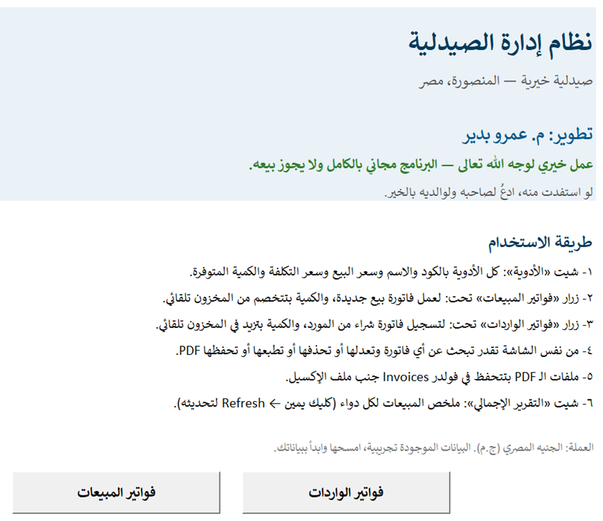
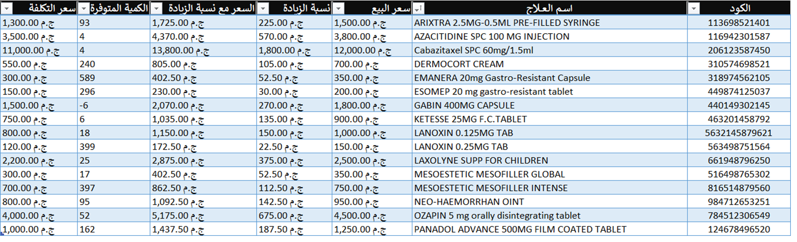
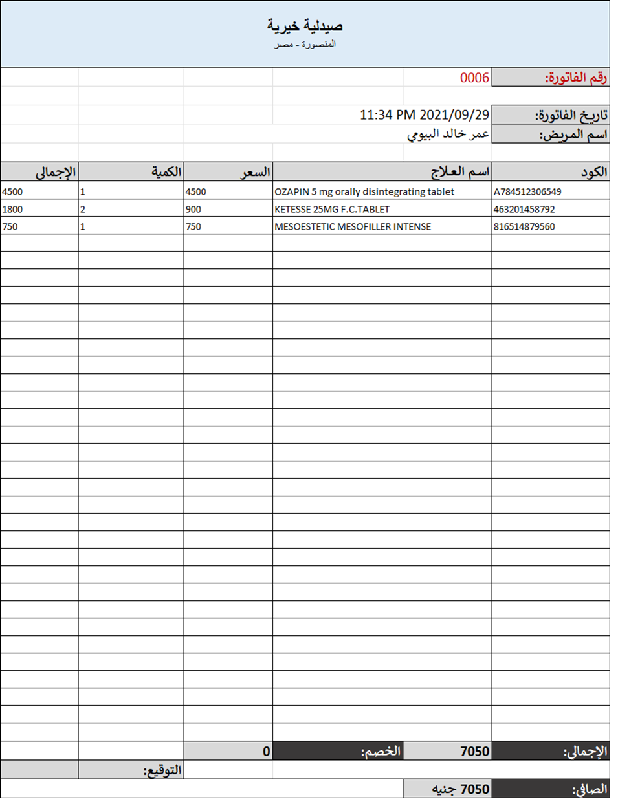
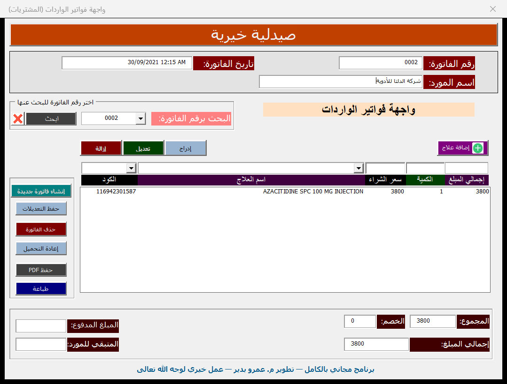
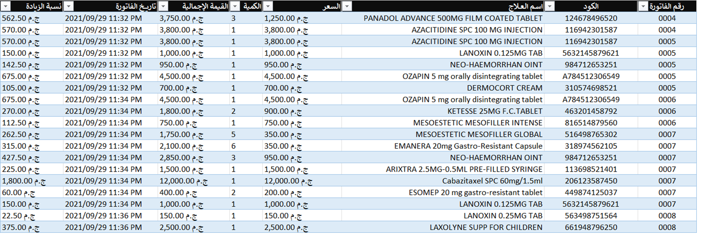

# 💊 نظام إدارة صيدلية — مجاني بالكامل (Excel)

نظام عربي متكامل لإدارة صيدلية صغيرة أو صيدلية خيرية، شغال جوه **Microsoft Excel** بالماكرو (VBA).
مش محتاج إنترنت ولا تسطيب برامج ولا قواعد بيانات. افتح الملف وابدأ شغل.

> **تطوير: م. عمرو بدير** 
> عمل خيري لوجه الله تعالى. البرنامج **مجاني بالكامل ولا يجوز بيعه**. لو استفدت منه، ادعُ لصاحبه ولوالديه بالخير. 🤍

  

---

## 📑 المحتويات

- [المميزات](#-المميزات)
- [المتطلبات](#-المتطلبات)
- [التحميل والتشغيل](#-التحميل-والتشغيل-خطوة-بخطوة)
- [شرح البرنامج بالصور](#-شرح-البرنامج-بالصور)
  - [شاشة البداية «عن البرنامج»](#1-شاشة-البداية-عن-البرنامج)
  - [الأدوية والمخزون](#2-شيت-الأدوية-والمخزون)
  - [فاتورة بيع جديدة](#3-عمل-فاتورة-بيع-جديدة)
  - [البحث والتعديل والحذف](#4-البحث-عن-فاتورة-وتعديلها-أو-حذفها)
  - [الطباعة وحفظ PDF](#5-الطباعة-وحفظ-pdf)
  - [إضافة علاج جديد](#6-إضافة-علاج-جديد)
  - [فواتير الواردات (المشتريات)](#7-فواتير-الواردات-المشتريات)
  - [سجلات الفواتير](#8-سجلات-الفواتير)
  - [التقرير الإجمالي](#9-التقرير-الإجمالي)
- [ابدأ ببيانات صيدليتك](#-ابدأ-ببيانات-صيدليتك)
- [مشاكل شائعة وحلولها](#-مشاكل-شائعة-وحلولها)
- [ملاحظات تقنية](#-ملاحظات-تقنية-للمطورين)
- [ادعم المشروع](#-ادعم-المشروع)

---

## ✨ المميزات

| | الميزة | التفاصيل |
|---|---|---|
| 💊 | **إدارة الأدوية** | الكود، الاسم، سعر البيع، سعر التكلفة، نسبة الزيادة، والكمية المتوفرة |
| 🧾 | **فواتير المبيعات** | إنشاء، بحث، تعديل، حذف. **المخزون بيتخصم تلقائي** |
| 📦 | **فواتير الواردات** | تسجيل المشتريات من الموردين. **المخزون بيزيد تلقائي** |
| 🖨️ | **طباعة و PDF** | نموذج فاتورة جاهز للطباعة، وحفظ أي فاتورة PDF بضغطة |
| 📊 | **تقرير إجمالي** | ملخص المبيعات لكل دواء (العدد والمبلغ) |
| 💰 | **الجنيه المصري** | كل المبالغ بالجنيه (ج.م) |
| 🌐 | **عربي بالكامل** | الواجهات والرسائل والفواتير، وشغال على أي إعدادات لغة في ويندوز |
| 🆓 | **مجاني 100%** | مفتوح المصدر، استخدمه وعدّله وانشره |

---

## 🖥️ المتطلبات

- **Windows** (7 أو أحدث).
- **Microsoft Excel 2010 أو أحدث** (يفضل Office 2016 / 2019 / 2021 / 365).
- ❌ مش بيشتغل على Excel للماك، ولا Excel Online، ولا Google Sheets، لأن الشاشات (UserForms) محتاجة Excel على ويندوز.

---

## ⬇️ التحميل والتشغيل خطوة بخطوة

1. من أعلى الصفحة اضغط الزرار الأخضر **Code** ← **Download ZIP**.
2. فك ضغط الملف في أي مكان (مثلاً على الـ Desktop).
3. **فك الحظر عن الملف** (مهم جداً، وإلا الماكرو مش هيشتغل):
   كليك يمين على `Pharmacy.xlsm` ← **Properties / خصائص** ← علّم على **Unblock / إلغاء الحظر** ← **OK**.
4. افتح `Pharmacy.xlsm`.
5. لو ظهر شريط أصفر فوق مكتوب فيه **Enable Content / تمكين المحتوى**، اضغط عليه.
6. هتفتح على شاشة **«عن البرنامج»**. اضغط **فواتير المبيعات** أو **فواتير الواردات** وابدأ.

> 📁 خلّي فولدر `Invoices` جنب ملف الإكسيل. فيه بتتحفظ فواتير الـ PDF، ولو اتمسح البرنامج بيعمله تاني لوحده.

---

## 📖 شرح البرنامج بالصور

### 1) شاشة البداية «عن البرنامج»

أول شيت بيفتح، وفيه بيانات البرنامج وطريقة الاستخدام وزرارين لفتح الشاشات الأساسية.

---

### 2) شيت «الأدوية» والمخزون

هنا كل الأدوية المسجلة. الأعمدة:

| العمود | معناه |
|---|---|
| **الكود** | كود الدواء (الباركود مثلاً). لازم يكون مختلف لكل دواء |
| **اسم العلاج** | الاسم التجاري |
| **سعر البيع** | السعر اللي بتبيع بيه للمريض |
| **نسبة الزيادة** و **السعر مع نسبة الزيادة** | بيتحسبوا تلقائي من النسبة اللي في الشيت |
| **الكمية المتوفرة** | المخزون الحالي، **بيتحدث لوحده** مع كل فاتورة بيع أو شراء |
| **سعر التكلفة** | سعر الشراء من المورد |

> 💡 الكمية بالسالب (زي `-6`) معناها إنك بعت أكتر من المسجل. سجّل فاتورة واردات للصنف ده.

---

### 3) عمل فاتورة بيع جديدة

افتح **فواتير المبيعات**. هتلاقي:
- **رقم الفاتورة** متكتب تلقائي (آخر رقم + 1).
- **التاريخ والوقت** متكتبين تلقائي (وتقدر تغيرهم).

**الخطوات:**
1. اكتب **اسم العميل** (اختياري).
2. اختار الدواء من قائمة **الكود** أو من قائمة **اسم العلاج**. السعر هيتكتب لوحده والكمية هتبقى 1.
3. غيّر **الكمية** لو محتاج. **إجمالي المبلغ** بيتحسب لوحده.
4. اضغط **إدراج** عشان الصنف يتضاف للجدول. كرر للأصناف التانية.
5. لتعديل صنف في الجدول: **دبل كليك** عليه ← غيّر ← **تعديل**. ولحذفه: دبل كليك ← **إزالة**.
6. اكتب **الخصم** لو فيه. **إجمالي المبلغ المطلوب** بيتحسب لوحده.
7. اختياري: اكتب **المبلغ المدفوع** والبرنامج يحسب **الباقي للعميل**.
8. اضغط **إنشاء فاتورة جديدة**. الفاتورة هتتحفظ وكميات الأصناف هتتخصم من المخزون.

---

### 4) البحث عن فاتورة وتعديلها أو حذفها

1. من خانة **البحث برقم الفاتورة** اختار الرقم ← **ابحث**.
2. بيانات الفاتورة وأصنافها هتظهر.
3. عدّل اللي انت عاوزه ← **حفظ التعديلات**. المخزون بيتظبط تلقائي (الكميات القديمة بترجع والجديدة بتتخصم).
4. أو اضغط **حذف الفاتورة** عشان تمسحها نهائياً. كمياتها بترجع للمخزون.
5. زرار **✖** الأحمر بيلغي البحث، و **إعادة التحميل** بيفضي الشاشة كلها.

---

### 5) الطباعة وحفظ PDF

بعد ما تبحث عن فاتورة:
- **طباعة**: بيفتح معاينة الطباعة لنموذج الفاتورة.
- **حفظ PDF**: بيحفظ الفاتورة في فولدر `Invoices` باسم رقم الفاتورة (مثلاً `0004.pdf`) ويفتحها.

نموذج الفاتورة المطبوعة (شيت `نموذج_الفاتورة`):

> ✏️ اسم الصيدلية والعنوان في أول خلية من شيت `نموذج_الفاتورة`، غيّرهم لبيانات صيدليتك.
> في أسفل كل فاتورة مطبوعة سطر صغير: «برنامج مجاني بالكامل — تطوير م. عمرو بدير».

---

### 6) إضافة علاج جديد

من زرار **إضافة علاج** في شاشة المبيعات أو الواردات:

اكتب **الكود** و **اسم العلاج** و **سعر الشراء** و **سعر البيع** ← **حفظ**.
البرنامج بيرفض الكود أو الاسم المكرر، والعلاج الجديد بيتسجل بكمية صفر لحد ما تعمله فاتورة واردات.

---

### 7) فواتير الواردات (المشتريات)

نفس طريقة المبيعات بالظبط، بس:
- بتكتب **اسم المورد** بدل اسم العميل.
- السعر اللي بيظهر هو **سعر الشراء** (التكلفة).
- عند الحفظ **الكمية بتزيد** في المخزون، وعند حذف الفاتورة **بتتخصم**.

---

### 8) سجلات الفواتير

كل فاتورة بتتسجل في شيتين: شيت للفواتير نفسها، وشيت للأصناف اللي في كل فاتورة.

**سجل فواتير المبيعات** (شيت `الفواتير`):

**أصناف فواتير المبيعات** (شيت `عمليات البيع`):

**سجل فواتير الواردات** (شيت `فواتير_الواردات`):

> ⚠️ متعدلش في الشيتات دي بإيدك. اعمل كل حاجة من الشاشات عشان المخزون يفضل مظبوط.

---

### 9) التقرير الإجمالي

ملخص لكل دواء: عدد مرات البيع وإجمالي المبلغ. تقدر تفلتر بالتاريخ من فوق.
لتحديثه بعد فواتير جديدة: **كليك يمين على التقرير ← Refresh / تحديث**.

---

## 🏁 ابدأ ببيانات صيدليتك

البيانات اللي في الملف **تجريبية** (أسماء وهمية). قبل ما تشتغل:

1. اعمل نسخة احتياطية من الملف.
2. امسح صفوف البيانات (من غير العناوين) من الشيتات: `الفواتير`، `عمليات البيع`، `فواتير_الواردات`، `عمليات_الواردات`.
3. في شيت `الأدوية` امسح الأدوية التجريبية، أو سيبها وعدّل الكميات.
4. سجّل أدويتك من زرار **إضافة علاج**، وبعدين اعمل **فاتورة واردات** بالكميات اللي عندك.
5. عدّل اسم الصيدلية في `نموذج_الفاتورة`.

> 💾 خد نسخة احتياطية من الملف كل يوم أو كل أسبوع (على فلاشة أو Google Drive).

---

## 🛠️ مشاكل شائعة وحلولها

| المشكلة | الحل |
|---|---|
| الزراير مش بتعمل حاجة / رسالة إن الماكرو متوقف | اعمل **Unblock** للملف من الخصائص (خطوة 3 فوق)، وبعدين **Enable Content** |
| Excel بيقول الملف من مصدر غير موثوق | File ← Options ← Trust Center ← Trust Center Settings ← Trusted Locations ← ضيف الفولدر اللي فيه الملف |
| حفظ PDF مش شغال | اتأكد إن الملف متحفوظ في فولدر عادي على الجهاز (مش مفتوح من الإيميل أو من جوه ملف ZIP) |
| رسالة «رقم الفاتورة المدخل موجود مسبقاً» | غيّر رقم الفاتورة، أو اضغط **إعادة التحميل** عشان ياخد رقم جديد تلقائي |
| رسالة «بيانات العنصر غير موجودة» | الدواء مش مسجل، ضيفه الأول من **إضافة علاج** |

---

## 👨‍💻 ملاحظات تقنية (للمطورين)

- **مقاوم لمشاكل اللغة:** كل النصوص العربية جوه الكود مكتوبة بأكواد Unicode عن طريق الدالة `AR()` في موديول `ArabicText`، والشيتات بتتنادى بأسمائها الداخلية (`Sheet7` = الأدوية…). كده البرنامج شغال على أي ويندوز، حتى لو خيار **Beta: Use Unicode UTF-8** مفعل، وحتى لو حد غيّر اسم أي شيت.
- **أهم الشاشات:** `Form_sales` (المبيعات)، `Form_purchase` (الواردات)، `Form_add_item_sales` / `Form_add_item_purchase` (إضافة علاج).
- **الجداول:** `Table_Sales` و `Table_invo_sales` (المبيعات)، `Table_purchase` و `Table_Inv_purchase` (الواردات).
- مسار حفظ الـ PDF بترجعه الدالة `InvoicesFolder()`.

### سجل التحديثات

- **2026-11:** نسخة مصرية: العملة جنيه، تصحيح النصوص العربية، أسماء تجريبية مصرية، شيت «عن البرنامج».
- **2026-11:** إصلاح البرنامج على ويندوز الحديث (مشكلة الترميز UTF-8 وأسماء الشيتات).
- إصلاح: حذف فاتورة واردات بقى بيخصم الكمية من المخزون بدل ما يزودها.
- إصلاح: شاشة «إضافة علاج» بقت بتسجل سعر البيع وسعر التكلفة كل واحد في مكانه الصح.
- إصلاح: أعمدة جدول الأصناف في الشاشات بقت مظبوطة تحت عناوينها.
- إصلاح: رقم الفاتورة مبقاش بيتغير لوحده لما ترجع للشاشة.

---

## 💚 ادعم المشروع

البرنامج مجاني وهيفضل مجاني. لو حابب تساعد:
- ⭐ اعمل **Star** للمشروع عشان يوصل لناس أكتر.
- 📤 ابعته لأي صيدلية خيرية أو صيدلي محتاجه.
- 🐞 لو لقيت مشكلة أو عندك اقتراح، افتح **[Issue](../../issues)**.
- 💖 ولو حابب تدعم تطوير المزيد من البرامج الخيرية: زرار **Sponsor** فوق في الصفحة.

---

## 📄 الترخيص

مجاني للاستخدام والتعديل والنشر لأي غرض خيري أو شخصي. **ممنوع بيعه.**
لو نشرته أو طورت عليه، يا ريت تحافظ على ذكر المطور الأصلي.

  <b>تطوير م. عمرو بدير</b> 
  عمل خيري لوجه الله تعالى 🤍

